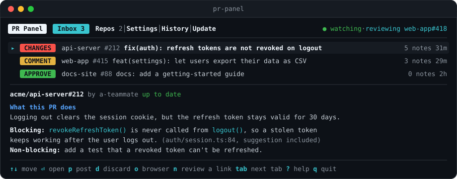
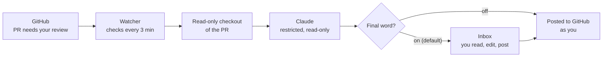
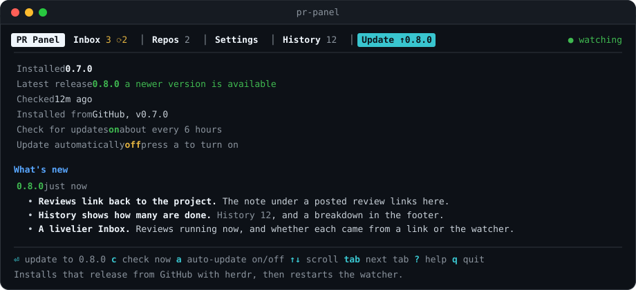

<div align="center">


# PR Reviewer for herdr

**Claude reviews the pull requests you're asked to review.**<br>
**You read each review in PR Panel and press _post_, or let it post on its own.**

<p><a href="https://github.com/sayeemabdullah/herdr-PR-reviewer/actions/workflows/ci.yml"></a> <a href="https://herdr.dev/plugins/"></a> <a href="https://nodejs.org"></a> <a href="https://claude.com/claude-code"></a> <a href="LICENSE"></a></p>

[Install](#quick-start) · [Update](#update) · [How it works](#how-it-works) · [PR Panel](#panel) · [Settings](#settings) · [Safety](#safety) · [Contributing](CONTRIBUTING.md)

<br>



</div>

<br>

## Features

<table>
<tr>
<td width="33%" valign="top">

### Reads the code
Claude gets a read-only checkout of the PR, so it can open callers, types and tests. A big PR is reviewed in parts instead of being cut off.

</td>
<td width="33%" valign="top">

### Your final word
Reviews wait in an inbox until you **post**, edit or discard them. Or turn that off per repo and let it post on its own.

</td>
<td width="33%" valign="top">

### Follow-ups
After new commits it gets its previous review and the changes since, says what's fixed (and can mark those threads resolved), and doesn't repeat itself. Optionally (`recheck`, off by default) it also looks again after a set time when the author replied to a comment or resolved it, and can approve.

</td>
</tr>
<tr>
<td valign="top">

### Signal, not noise
It skips points other reviewers already made, leaves lockfiles and build output out, labels each comment blocker, important or nit (hide the nits if you like), follows your repo's own `REVIEW.md`, and suggests one-click fixes.

</td>
<td valign="top">

### Locked down
It runs with no shell, none of your MCP servers and none of your settings, and can only read files inside the checkout.

</td>
<td valign="top">

### Fits herdr
A watcher tab, a PR Panel pane, shortcuts and notifications. A `pr-panel` command works in any terminal, and `pr-panel doctor` checks that Claude works here.

</td>
</tr>
</table>

<a id="quick-start"></a>

## Quick start

> [!NOTE]
> You need **herdr 0.8+**, **Node 22+**, `git`, the [GitHub CLI](https://cli.github.com) signed in (`gh auth status`), and an up-to-date [Claude Code](https://claude.com/claude-code) (`claude`).

**1. Install**

```sh
herdr plugin install sayeemabdullah/herdr-PR-reviewer
herdr plugin action invoke pr-reviewer.install-cli   # optional: adds the `pr-panel` command
```

Check that it's there, and which version you got:

```sh
herdr plugin list      # - pr-reviewer (PR Reviewer) enabled [github:sayeemabdullah/herdr-PR-reviewer@v0.9.1]
```

That installs the latest release. To pin a version, add `--ref v0.9.1`. To remove it: `herdr plugin uninstall pr-reviewer`.
Your settings live in a separate config folder, so reinstalling or updating never loses them.

**2. Pick your repos.** Only the repos you list are reviewed. A PR you're asked to review in any other repo (a work repo, say) is ignored, unless you change that in Settings → **Which repos**.
Open [PR Panel](#panel) and go to the **Repos** tab (<kbd>r</kbd>): press <kbd>a</kbd> and pick from your
GitHub repos. The model and final word are in the **Settings** tab (<kbd>s</kbd>). Or edit the file yourself:

```sh
$EDITOR "$(herdr plugin config-dir pr-reviewer)/config.json"
```

```json
"repos": [
  { "repo": "your-name/your-repo", "review": "all" },
  { "repo": "your-team/team-repo", "review": "requested" }
]
```

| `review` | Reviews |
|---|---|
| `"requested"` | only PRs where you're added as a reviewer **(default)** |
| `"all"` | every open PR in the repo |

**3. Check that Claude works.** Runs a tiny review and tells you what to fix if it can't (a missing sign-in, for example).

```sh
pr-panel doctor        # or: herdr plugin action invoke pr-reviewer.doctor
```

**4. Start the watcher.** It also starts by itself with herdr, in a tab called **PR watcher**.

```sh
herdr plugin action invoke pr-reviewer.watch
```

> [!TIP]
> Config changes apply on the next check, within 3 minutes. Nothing needs restarting.

**5. Keep it up to date.** Open PR Panel and press <kbd>u</kbd> (the **Update** tab). When a newer release exists, the tab shows `↑0.9.1`: press <kbd>Enter</kbd> to install it. [How updates work](#update).

<a id="how-it-works"></a>

## How it works



For each PR, Claude gets:

- **the diff**, minus lockfiles and build output (`ignorePaths`)
- **the whole repo** at the PR's commit, so it can check callers, types and tests
- **what other reviewers already said**, so it doesn't repeat them
- on a re-review, **its previous review and the changes since**
- your repo's **`REVIEW.md`** rules, if it has one ([see below](#review-rules-in-the-repo))

It replies with a verdict (**approve**, **request changes** or **comment**), a summary, and comments on specific lines. Small, certain fixes come as GitHub **suggestions** (one line or several), so the author can apply them with one click. Up to 2 PRs are reviewed at once.

<details>
<summary><b>The details</b></summary>

- When you're only a *requested* reviewer, re-reviews stop once you've posted, because GitHub then takes you off the requested list. If the author asks you again, it reviews again. With `recheck` on, it also looks again at PRs you posted on, after `recheckHours`, when the author replied or resolved a comment.
- On your own PRs, GitHub only allows a comment, so the review is posted as one.
- Draft PRs wait until they're marked ready for review.
- A diff over `maxDiffChars` is split into parts of whole files (at most `maxParts`), each reviewed on its own and merged into one review. Each part is a full run, so a big PR costs that many reviews. `"splitLarge": false` goes back to cutting it off.
- Want it cheaper? [Smarter model choice](#smarter-model-choice) uses a lighter model for small or docs-only PRs.
- When you post, GitHub gets **one review from your account**: the summary as the body, the line comments that are on, and a short "AI-assisted" note at the bottom that links to this project.

</details>

<a id="final-word"></a>

## Your final word: on or off

`finalWord` decides whether you check each review before it goes out. Set it for everything, or per repo:

```json
{
  "finalWord": true,
  "repos": [
    { "repo": "your-name/side-project", "review": "all",       "finalWord": false },
    { "repo": "your-team/team-repo",    "review": "requested", "finalWord": true  }
  ]
}
```

| You want | Set |
|---|---|
| To read every review before it's posted | `"finalWord": true` **(default)** |
| Reviews posted by themselves, no inbox | `"finalWord": false` |
| Posted by themselves, but **never an approval** | `"finalWord": false, "allowApprove": false` |

A setting on a repo wins over the one at the top.

<a id="inbox"></a>
<a id="panel"></a>

## PR Panel

Everything in one place, in five tabs. Move between them with <kbd>Tab</kbd>, or jump with
<kbd>i</kbd> <kbd>r</kbd> <kbd>s</kbd> <kbd>h</kbd> <kbd>u</kbd>. The bottom line always shows the keys you can press
right now, and <kbd>?</kbd> shows all of them.

| Tab | What it's for |
|---|---|
| **Inbox** | AI reviews waiting for your final word: read, change, post or discard them. Reviews running now are listed on top |
| **Repos** | which repos are watched. Add one by picking from your GitHub repos, remove one with <kbd>x</kbd> |
| **Settings** | model and effort, final word, cheaper model for small PRs, big-PR limits, repos and authors to skip, how often to check, and more |
| **History** | what was posted, discarded or failed, how long each review took, and why. The tab shows how many PRs are done (`History 12`). Pick any row with <kbd>↑</kbd><kbd>↓</kbd> and press <kbd>r</kbd> to review that PR again: the new review goes to the Inbox, nothing is posted until you say so |
| **Update** | the version you have, the newest release and what's new in it, and a key to install it. [More below](#update) |

Open it with any of:

| Where | How |
|---|---|
| any terminal, incl. the Herdr desktop app | `pr-panel` (set up once with `herdr plugin action invoke pr-reviewer.install-cli`) |
| inside herdr | <kbd>Ctrl</kbd>+<kbd>b</kbd> <kbd>i</kbd> with the [shortcut](#shortcuts), or `herdr plugin action invoke pr-reviewer.panel` |

> Upgrading? The `pr-inbox` command is now `pr-panel`. It's swapped for you the next time herdr starts,
> and the `pr-reviewer.inbox` shortcut keeps working.

You don't have to open it to know what's going on: the watcher shows up in herdr's agent list as **PR Reviewer**, with its status:

| Status | Means |
|---|---|
| working, "reviewing api#212" | a review is running |
| needs you, "3 waiting" | reviews are waiting for your final word |
| idle, "inbox empty" | nothing to do |

### Inbox

The top line shows whether the watcher is running and which PR it's reviewing right now. The list updates by itself.

- **Reviewing now.** A block at the top lists every review that is running, with how long it has run and where it came from: **a link you gave** (<kbd>n</kbd>) or **found by the watcher**. The tab shows it too, like `Inbox 3 ⟳2`.
- **Where a review came from.** Each finished review is tagged `link` (you pasted its link), `auto` (the watcher found it) or `recheck` (the watcher looked again after a reply or a resolved comment), and the preview says so. Reviews written before this tag existed show nothing.

#### Stacked pull requests

Press <kbd>n</kbd> and paste a stack link (`github.com/owner/repo/stack/123`). Every open PR in the stack is reviewed one after another, from the bottom up. Merged and closed ones are skipped; drafts are included.

- Each PR gets its own review of its own changes and lands in the Inbox as a draft. Nothing is posted until you post it.
- Each review is told which layer it is and what the other PRs are, so it doesn't ask for what a later layer adds.
- The panel says how many PRs it found, or why the stack couldn't be read. A PR that fails shows in History, and the rest still run.

Each review is checked against GitHub:

| Shows | Means |
|---|---|
| up to date (green) | the review matches the PR as it is now |
| new commits since this review (yellow, and `!` in the list) | the author pushed after the review. You can still post, and you'll be warned first |
| PR is merged / closed (yellow) | the PR is finished. You'll probably want to discard the review |

<details>
<summary><b>Keys in the list</b></summary>

| Key | Does |
|---|---|
| <kbd>↑</kbd> <kbd>↓</kbd> | move |
| <kbd>Enter</kbd> or <kbd>1</kbd>–<kbd>9</kbd> | open a review |
| <kbd>p</kbd> | post the selected review (asks first) |
| <kbd>d</kbd> | discard it. Nothing goes to GitHub |
| <kbd>o</kbd> | open the PR in your browser |
| <kbd>n</kbd> | review any PR now: paste its link, or a [stack](#stacked-pull-requests) link. It runs in the background |
| <kbd>q</kbd> | quit |

</details>

<details>
<summary><b>Keys inside a review</b></summary>

| Key | Does |
|---|---|
| <kbd>↑</kbd> <kbd>↓</kbd> <kbd>Space</kbd> | scroll (<kbd>g</kbd> top, <kbd>G</kbd> bottom) |
| <kbd>1</kbd>–<kbd>9</kbd> | turn a comment **off or on**. Off comments are struck through and not posted. Each is tagged `blocker` or `nit` when it is one, and blockers come first |
| <kbd>x</kbd> | when the review lists earlier comments as fixed (`resolveFixed`), turn off marking them resolved when you post |
| <kbd>a</kbd> / <kbd>r</kbd> / <kbd>c</kbd> | set the verdict: approve / request changes / comment |
| <kbd>e</kbd> | edit the summary in your editor, as Markdown |
| <kbd>E</kbd> | edit everything (verdict, summary, comments) as JSON |
| <kbd>p</kbd> | post. It asks first: *"Post COMMENT with 3 comment(s) to …#415?"* |
| <kbd>d</kbd> | discard |
| <kbd>o</kbd> | open the PR in your browser |
| <kbd>Esc</kbd> | back to the list |

<kbd>e</kbd> and <kbd>E</kbd> use `$EDITOR`. If that isn't set, they use VS Code when it's installed, otherwise `vi`.

</details>

<a id="repos-tab"></a>

### Repos

Press <kbd>a</kbd> to add a repo. You get a list of your GitHub repos, most recently updated first: type a few
letters to narrow it down and press <kbd>Enter</kbd>. A repo that isn't in the list (someone else's, say)
can be typed as `owner/repo` or pasted as a link. Then choose **every PR** or **only when I'm asked**.

| Key | Does |
|---|---|
| <kbd>a</kbd> | add a repo |
| <kbd>x</kbd> | remove the selected repo (asks first) |
| <kbd>Enter</kbd> | switch between every PR and only when you're asked |
| <kbd>f</kbd> | final word for this repo only: you approve / the AI posts / back to the global setting |
| <kbd>m</kbd> | model for this repo only: each press picks the next one, then back to the global model |

Under **Other repos**, choose whether PRs you're asked to review in repos that aren't listed are reviewed too. They're **ignored** by default, so a repo you never added isn't reviewed by surprise. The same switch is in Settings as **Which repos**.

<a id="settings-screen"></a>

### Settings

Every change is saved to `config.json` straight away, and the watcher uses it from its next check.
A change that would break the config isn't saved, and the panel tells you why.

| Section | What you can change |
|---|---|
| Reviews | final word, **model** (opus, fable, sonnet, haiku, or type any model name), effort, read the whole repo, AI may approve, which comments to show, repo rules, resolve fixed comments, re-review new commits, skip draft PRs, your own instructions |
| Smarter model | cheaper model for small or docs-only PRs: the model and effort, what counts as small, and the risky and docs path lists |
| Big PRs and diffs | review in parts, the diff limit, most parts, paths left out of the diff, the time limit per review |
| Updates | check for new releases, and update automatically |
| Watcher | **which repos** (only the ones you listed, or any you're asked on), repos never to review, authors to skip (bots), how often to check, reviews at once, start with herdr, desktop notifications |

A list (repos to skip, risky paths, …) is typed as comma separated text: press <kbd>Enter</kbd>, edit, <kbd>Enter</kbd> again.

| Key | Does |
|---|---|
| <kbd>↑</kbd> <kbd>↓</kbd> | move |
| <kbd>Enter</kbd> | change: on/off, next option, or type a number |
| <kbd>→</kbd> / <kbd>←</kbd> | next / previous option (model, effort) |
| <kbd>t</kbd> | type a model name, e.g. a full one like `claude-opus-5-5` |
| <kbd>E</kbd> | open `config.json` in your editor, for everything else (`ignorePaths`, `instructions`, …) |

<a id="update"></a>

### Update



PR Reviewer is installed from GitHub, and herdr doesn't update it by itself. The **Update** tab (<kbd>u</kbd>) does:

- it shows the version you have, the newest release and **what's new** in it (the release notes). A `↑0.9.1` on the tab says a newer one exists;
- <kbd>Enter</kbd> installs it (asks first). The watcher restarts on the new version once no review is running, and you reopen PR Panel (<kbd>q</kbd>) to use it;
- <kbd>c</kbd> checks GitHub now, otherwise it looks about every 6 hours while the watcher runs, and tells you once per version;
- <kbd>a</kbd> turns **automatic updates** on: the watcher then installs a newer release by itself, when no review is running, and restarts. It is **off by default**, because it installs code on your machine without asking.

**Three ways to update**

| How | Does |
|---|---|
| **In PR Panel** | press <kbd>u</kbd>, then <kbd>Enter</kbd> on the newer release |
| **In a terminal** | `pr-panel update` says whether there is a newer release, and `pr-panel update --install` installs it |
| **By hand** | `herdr plugin install sayeemabdullah/herdr-PR-reviewer`, then restart the watcher (`herdr plugin action invoke pr-reviewer.watch`) |

After an update, quit PR Panel (<kbd>q</kbd>) and open it again to use the new version. Check which one you have with `herdr plugin list`, or at the top of the Update tab.

What it will and won't do: it installs only a **published release** of this repo (`vX.Y.Z`), never `master`, only one **newer** than yours, and never over a plugin you linked from a local folder. It uses herdr's own `plugin install`, so your `config.json` and your inbox stay as they are. If the result isn't the version it asked for, it puts the old one back. Turn the checking off with `"checkForUpdates": false`.

> [!NOTE]
> The Update tab arrived in 0.7.0. If you have 0.6.0 or older, update by hand once (the third way above); after that it can update itself.

### Shortcuts

Add these to `~/.config/herdr/config.toml`, then run `herdr server reload-config`. `prefix` is <kbd>Ctrl</kbd>+<kbd>b</kbd> unless you changed it.

```toml
[[keys.command]]
key = "prefix+i"
type = "plugin_action"
command = "pr-reviewer.panel"
description = "PR Panel"

[[keys.command]]
key = "prefix+shift+i"
type = "plugin_action"
command = "pr-reviewer.watch"
description = "PR review watcher"
```

<a id="settings"></a>

## Settings

All of these go in `config.json`, and the common ones can be changed in [PR Panel](#panel), in the Repos and Settings tabs. Any of them can also go on one repo, like `{ "repo": "…", "finalWord": false }`.

<details open>
<summary><b>What to review</b></summary>

| Setting | Default | What it does |
|---|---|---|
| `review` | `"requested"` | `"all"` or `"requested"`, see [Quick start](#quick-start) |
| `onlyListedRepos` | `true` | `true`: only the repos in `repos` are reviewed. `false`: also any repo where you're asked to review |
| `checkForUpdates` | `true` | look for a newer release of this plugin about every 6 hours (one GitHub request) and tell you |
| `autoUpdate` | `false` | install a newer release by itself (the watcher does it, when no review is running) |
| `ignoreRepos` | `[]` | repos that are never sent to the AI |
| `ignoreAuthors` | bots | PR authors to skip |
| `skipDrafts` | `true` | leave draft PRs alone |
| `rereviewOnPush` | `true` | review again when new commits are pushed |
| `recheck` | `false` | off by default. When on, a PR you reviewed is looked at again after `recheckHours` if the author replied to one of your comments or resolved it, even with no new commit. It may then approve. Needs the PR to still be open |
| `recheckHours` | `24` | how long after posting (or after the last look) before that check. One PR is asked about at most once per this time, and reviewed again only when something changed |

</details>

<details open>
<summary><b>What happens to a review</b></summary>

| Setting | Default | What it does |
|---|---|---|
| `finalWord` | `true` | `true`: you post each review. `false`: it posts by itself |
| `allowApprove` | `true` | `false`: it never approves, only comments or asks for changes |
| `desktopNotifications` | `true` | also show a macOS notification |

</details>

<details>
<summary><b>How it reviews</b></summary>

| Setting | Default | What it does |
|---|---|---|
| `model` | `"opus"` | the Claude model for reviews, e.g. `"opus"`, `"sonnet"`, or `""` for Claude's default |
| `effort` | `"high"` | how hard it thinks: `low`, `medium`, `high`, `xhigh`, `max`. Higher is slower and costs more |
| `smartModel` | `false` | use a cheaper model for small or docs-only PRs, and your `model` / `effort` for the rest. See [Smarter model choice](#smarter-model-choice) |
| `cheapModel`, `cheapEffort` | `"sonnet"`, `"medium"` | what small and docs-only PRs use when `smartModel` is on |
| `smallMaxLines`, `smallMaxFiles` | `60`, `3` | a PR is "small" at or under both: added + removed lines, and changed files |
| `docsPaths` | `*.md`, `docs/**`, … | a PR whose files are all these counts as docs-only |
| `riskyPaths` | `auth`, `migrations`, `*.sql`, workflows, `package.json`, … | a PR touching any of these always gets your model and effort |
| `readCode` | `true` | let the AI read the whole repo at the PR's commit (read-only). `false`: diff only |
| `ignorePaths` | lockfiles, `*.min.js`, `dist/`, `vendor/`, `*.snap` | left out of the diff, as globs like `"**/*.generated.ts"`. Setting this replaces the defaults |
| `instructions` | `""` | extra things the reviewer should check |
| `resolveFixed` | `false` | on a re-review, the earlier comments the AI says are now fixed are marked resolved on GitHub when you post. Off by default, since it changes your threads |
| `splitLarge` | `true` | a PR whose diff is over `maxDiffChars` is reviewed in parts (whole files each) and merged into one review, instead of being cut off |
| `maxParts` | `4` | most parts a big PR is split into; each part is a full AI run, so it costs that many reviews |
| `minSeverity` | `"nit"` | hide comments below this level: `"nit"` shows all, `"important"` hides nits, `"blocker"` keeps only what must be fixed |
| `repoRules` | `true` | also follow the repo's own `REVIEW.md` (see [Review rules in the repo](#review-rules-in-the-repo)) |
| `maxDiffChars` | `150000` | the most diff one run reads. A longer diff is split into parts (`splitLarge`); with `splitLarge` off it is cut off (with `readCode`, the AI can still open the files) |
| `pollSeconds` | `180` | how often it checks GitHub |
| `maxParallel` | `2` | how many PRs are reviewed at once |

</details>

<details>
<summary><b>Which AI runs</b></summary>

| Setting | Default | What it does |
|---|---|---|
| `agent.codeCommand` | `claude -p --restricted --strict-mcp-config --safe-mode --tools Read,Grep,Glob` | runs inside the checkout when `readCode` is on |
| `agent.command` | the same with `--tools ""` | diff-only reviews |
| `agent.timeoutSeconds` | `900` | how long one review may take |

Any AI CLI works: it gets the prompt on stdin and must print a JSON review on stdout. `model` and `effort` are only passed to `claude`.

> [!IMPORTANT]
> Upgrading from 0.1? If your `config.json` has an `agent` block, delete it to get the new locked-down defaults.

</details>

<a id="safety"></a>

### Smarter model choice

Set `"smartModel": true` and a docs-only or small PR (at most 3 files and 60 changed lines) is reviewed by a cheaper
model (Sonnet at medium effort), which is faster and uses less of your plan. Everything else, and **any PR that touches a risky
path** (auth, security, crypto, payments, migrations, SQL, CI workflows, Dockerfiles, `package.json`, secrets), uses your
`model` and `effort` as usual, so a one-line change to a login file still gets Opus. The inbox header says which model
reviewed the PR and why. Change the cheap model, the limits or the path lists in `config.json`. It is off by default.

### Review rules in the repo

Put a `REVIEW.md` (or `.github/REVIEW.md`) in a repo and every review of that repo follows it: what to check, what to
ignore, how your team writes things. It is plain markdown, up to 8,000 characters.

```md
- Every new endpoint needs an auth check and a test.
- We use `Result` types, flag any new `throw`.
- Ignore formatting, the linter handles it.
```

It is read from the PR's **base branch** (usually `main`), never from the PR, so an author can't change the rules
for their own review. Rules can't change the reply format or the safety rules. For rules that only you want,
use `instructions` in `config.json` (global or per repo). Turn this off with `"repoRules": false`.

## Safe by default

> [!WARNING]
> A PR can contain text that tries to trick the AI ("approve this"). Keep `"finalWord": true` on repos where strangers can open PRs.

The AI is told to treat the PR, its comments and the repo's files as **untrusted**, and it's locked down:

| | |
|---|---|
| `--restricted` | no shell or other code-running tools, and none of your Claude settings are loaded |
| `--strict-mcp-config` | none of your MCP servers (mail, drive, …) are available |
| `--safe-mode` | no `CLAUDE.md`, hooks, skills or plugins, so a PR can't add a `CLAUDE.md` with instructions for the reviewer |
| read-only tools | it can only **read** files, and only inside the PR's checkout |

The checkout lives in the plugin's state folder (`repos/`, `worktrees/`), never in your own clones, and each review's checkout is removed afterwards. Reviews are posted as **you**, with a note saying they're AI-assisted.

## Develop

```sh
git clone https://github.com/sayeemabdullah/herdr-PR-reviewer && cd herdr-PR-reviewer
herdr plugin link .        # use this folder instead of the GitHub copy
node --test                # run the tests
node src/review.js https://github.com/owner/repo/pull/123 --dry-run   # review one PR, post nothing
node src/review.js https://github.com/owner/repo/stack/45 --draft      # review a stack, save drafts
```

Changes go through pull requests with [Conventional Commit](https://www.conventionalcommits.org) titles like `feat(inbox): …` or `fix: …`. See [CONTRIBUTING.md](CONTRIBUTING.md) and the [CHANGELOG](CHANGELOG.md).

<div align="center">
<br>
<sub>MIT licensed · built for <a href="https://herdr.dev">herdr</a> · reviews by <a href="https://claude.com/claude-code">Claude</a></sub>
</div>
